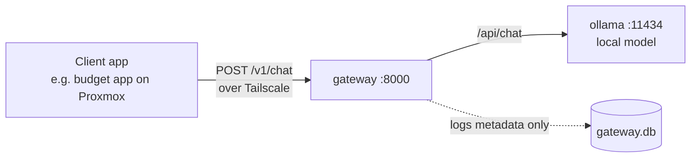

# Integrating with the Private AI Gateway

This gateway is a standalone service. Apps use it **over HTTP**. They never import its code or embed this repo (no submodules, no copied files). The API described here is the contract: if it changes in a breaking way, a new version (`/v2`) is added and `/v1` keeps working.



## Connecting

The gateway runs on **Eli-Mini-PC** (Windows + Docker Desktop). Its port is bound to `127.0.0.1`, so it's never exposed on the LAN. How a client reaches it depends on where the client runs:

| Client location | How it connects | `GATEWAY_URL` |
| --- | --- | --- |
| Another machine (e.g. the budget app on Proxmox), or an iPhone | Over **Tailscale only** (WireGuard-encrypted), through `tailscale serve` | `https://eli-mini-pc.<tailnet>.ts.net` |
| A container in another compose project on the mini PC | Docker Desktop's host alias | `http://host.docker.internal:8000` |
| Directly on the mini PC (scripts, tests) | Loopback | `http://127.0.0.1:8000` |

**Publishing to the tailnet.** On the mini PC, `tailscale serve --bg 8000` proxies HTTPS on the machine's tailnet name to `127.0.0.1:8000`. Flags vary by Tailscale version, so check `tailscale serve --help`. Never open router ports, and never bind the gateway to `0.0.0.0` on the host.

**Authentication.** This is *planned (Milestone 8)*: once the gateway is reachable from other machines, every request except `/health` must send `Authorization: Bearer <GATEWAY_API_KEY>`. Requests without a valid key get **401**. Each client keeps the key in its own gitignored `.env`.

Always configure clients with an environment variable, never a hard-coded address.

## Endpoints

### `POST /v1/chat`

Chat with the local model. Optionally require the reply to be JSON matching a schema.

**Request**

| Field | Type | Required | Notes |
| --- | --- | --- | --- |
| `messages` | list of `{role, content}` | yes | `role` is `system`, `user` or `assistant`. At least 1 message. |
| `model` | string | no | Defaults to the gateway's `DEFAULT_MODEL` (`llama3.2:3b`). |
| `json_schema` | JSON Schema object | no | If set, the reply is constrained to this schema, validated, and retried up to `MAX_RETRIES` times. |
| `max_tokens` | int, 1–2048 | no | Default 256. |
| `private` | bool | no | Default `true`. Private requests always stay on the local model. (Every request is local today. This guarantees it stays that way once hosted-model routing exists.) |

**Response (200)**

```json
{
  "content": "{\"category\": \"Food\"}",
  "parsed": {"category": "Food"},
  "model": "llama3.2:3b",
  "route": "local",
  "attempts": 1,
  "timings": {"prompt_tokens": 105, "output_tokens": 10, "prompt_s": 2.33,
              "eval_s": 0.901, "load_s": 0.002, "total_s": 3.245}
}
```

- `parsed` is only filled in when `json_schema` was sent. Use it instead of parsing `content` yourself.
- `attempts` greater than 1 means the first reply was invalid and the gateway corrected it.

**Example: categorize a transaction**

```json
{
  "messages": [
    {"role": "system", "content": "Categorize bank transactions. Coffee shops and restaurants are Food."},
    {"role": "user", "content": "STARBUCKS #1234 TAMPA FL $6.45"}
  ],
  "json_schema": {
    "type": "object",
    "properties": {"category": {"type": "string",
      "enum": ["Food", "Groceries", "Transport", "Housing", "Shopping", "Bills", "Entertainment", "Other"]}},
    "required": ["category"]
  },
  "max_tokens": 30
}
```

### `GET /health`

`200` with `{"status": "ok", "ollama": true, "default_model": "...", "models": [...]}` when the gateway can reach Ollama. `503` when it can't. Use it for startup checks.

### `GET /stats?last=500`

Success rate, retry rate, p50/p95/max latency and average prompt tokens over the last N requests.

## Errors

Every error returns JSON with a `detail` field explaining the problem.

| Code | Meaning | What the client should do |
| --- | --- | --- |
| 400 | `json_schema` isn't a valid JSON Schema | Fix the schema; don't retry |
| 401 | Missing or wrong API key (planned, Milestone 8) | Fix the client's `GATEWAY_API_KEY`; don't retry |
| 422 | The request body is malformed (e.g. empty `messages`) | Fix the request; don't retry |
| 429 | Rate limit hit (`RATE_LIMIT_PER_MIN`, default 30 per client) | Wait the number of seconds in the `Retry-After` header |
| 502 | Ollama returned an error, or the output was still invalid after all retries | Fall back (e.g. leave the item uncategorized for review) |
| 503 | The gateway can't reach Ollama | Retry later; check `docker compose ps` |
| 504 | Ollama took longer than `OLLAMA_TIMEOUT_S` | Retry later or send a shorter prompt |

## Client guidelines

- **Wrap the gateway in one client function** in your app, so the rest of the code never builds HTTP requests itself.
- **Use `json_schema` whenever your code consumes the answer.** Never parse free text.
- **Do math in your own code or SQL, not in the model.** The model chooses and describes; it doesn't calculate.
- **Keep the system prompt identical across calls** and put the variable part last. Ollama caches the shared prefix, which cut agent latency by about 60% in benchmarks.
- **Expect seconds, not milliseconds.** This runs on a CPU-only mini PC. Use timeouts of 60–120 seconds and don't call it on every keystroke.
- **Keep your client timeout below any proxy in front of you** (for example nginx's `proxy_read_timeout`), so a slow request fails with your own readable error instead of the proxy's bare 504.
- **Never call the gateway inline in a bulk job** (like a 365-day bank sync). Queue the work and process it in small batches in the background.
- **Send the model only the fields it needs.** For categorizing, that's the payee text and the inflow/outflow sign, not account names or balances.

## Privacy

- The gateway logs timings, token counts and success only, **never prompt or answer text**.
- No request goes to a hosted AI provider: Ollama is the only backend. Remote callers reach the gateway only over Tailscale, so data between machines is always encrypted.
- Client repos must never commit real personal data. Use synthetic sample data for tests and demos.

## Configuration (gateway environment variables)

| Variable | Default | Purpose |
| --- | --- | --- |
| `OLLAMA_URL` | `http://ollama:11434` | Where the model runtime is |
| `DEFAULT_MODEL` | `llama3.2:3b` | Used when a request doesn't name a model |
| `MAX_RETRIES` | `2` | Extra attempts when schema validation fails |
| `RATE_LIMIT_PER_MIN` | `30` | Requests per minute per client |
| `OLLAMA_TIMEOUT_S` | `300` | How long to wait for the model |
| `DB_PATH` | `/data/gateway.db` | Request log (metadata only) |
